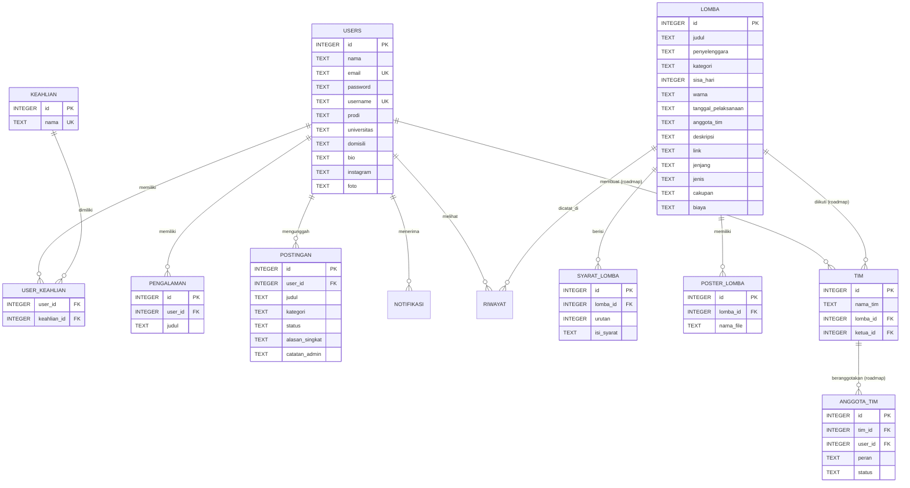

# Pertemuan 9 — Database Design & Native Query (TeamUp)

Topik RPS: *Presentasi perancangan skema database relasional/lokal dan pemilihan ORM atau native query.*

File terkait:
* `database/schema.sql`: Definisi struktur DDL (tabel, primary key, foreign key, index).
* `database/db.py`: Modul koneksi SQLite dan fungsi helper query native.
* `database/seeder.py`: Skrip migrasi data awal dari mock `data_store.py` ke `teamup.db`.
* `tes_database.py`: Skrip demonstrasi pengujian koneksi, relasi JOIN, dan integritas data untuk presentasi.

---

## 1. Konsep & Arsitektur Database

### Mengapa Memilih SQLite untuk Aplikasi Desktop?
1. **Serverless & Zero Configuration:** SQLite tidak memerlukan software server terpisah (seperti MySQL di XAMPP / PostgreSQL). Seluruh basis data disimpan dalam satu file lokal: `teamup.db`.
2. **Portabilitas Pengujian:** Saat dosen atau anggota kelompok menjalankan aplikasi di laptop masing-masing, tidak perlu setup database manual atau import `.sql`.
3. **Standar Aplikasi Desktop Modern:** Browser (Chrome/Firefox), aplikasi chat (Telegram/WhatsApp Desktop), hingga aplikasi mobile menggunakan SQLite sebagai tempat penyimpanan persisten lokal.
4. **Mode WAL (Write-Ahead Logging):** Mengaktifkan `PRAGMA journal_mode = WAL;` sehingga operasi pembacaan di background thread (dari Pertemuan 7) tidak terblokir ketika ada thread lain yang menulis.

---

## 2. Pemilihan: Native Query (`sqlite3`) vs ORM

Sesuai instruksi RPS (*"pemilihan ORM atau native query"*), kelompok kami memilih **Native Query menggunakan modul bawaan `sqlite3`**.

| Aspek | Native Query (`sqlite3`) — **Pilihan Kami** | ORM (misal: SQLAlchemy / Peewee) |
|---|---|---|
| **Dependensi Eksternal** | Nol (Built-in standar Python). | Memerlukan install library pihak ketiga (`pip install`). |
| **Kontrol & Transparansi** | 100% kontrol langsung atas sintaks SQL murni (`CREATE`, `SELECT`, `JOIN`). | Melakukan abstraksi otomatis di balik layar (*black-box*). |
| **Kesesuaian Akademik** | Selaras dengan mata kuliah Basis Data (memahami DDL, DML, dan normalisasi relasional). | Fokus pada pemetaan objek class, sintaks SQL tertutup. |
| **Performa & Overhead Memori** | Sangat ringan, mengeksekusi langsung tanpa overhead konversi objek model ORM. | Ada sedikit overhead memori untuk memetakan setiap baris menjadi objek class. |
| **Pencegahan SQL Injection** | Aman dengan parameterized query (`?` placeholder). | Aman dengan query builder bawaan ORM. |

**Argumen Teknis untuk Dosen:**  
> *"Kami memilih Native Query agar memiliki kontrol penuh terhadap efisiensi query relasional (terutama JOIN antartabel) dan memahami alur dasar data persistence sebelum beralih ke layer abstraksi ORM di proyek berskala besar."*

---

## 3. Diagram Relasi Entitas (ERD)



---

## 4. Normalisasi dan Struktur Skema Database

Skema telah memenuhi kaidah **Bentuk Normal Ketiga (3NF)**:
1. **1NF (First Normal Form):** Tidak ada kolom bernilai ganda (*repeating groups*). Syarat lomba, gambar poster, dan keahlian dipecah menjadi tabel terpisah.
2. **2NF (Second Normal Form):** Semua atribut non-kunci bergantung penuh pada Primary Key masing-masing tabel.
3. **3NF (Third Normal Form):** Tidak ada ketergantungan transitif (*transitive dependency*). Data master keahlian dipisah ke tabel `keahlian` tersendiri dan dihubungkan via tabel pivot `user_keahlian`.

### Aturan Penyimpanan Media (Gambar & Dokumen):
* **Bukan BLOB:** File fisik gambar foto profil dan poster lomba **TIDAK disimpan dalam database** sebagai binary data (karena membebani ukuran basis data dan memori).
* **Path / Filename Reference:** Database hanya menyimpan teks nama berkas (misal: `"marques.png"` atau `"poster_uiux.png"`). File fisik diletakkan pada folder lokal `assets/foto/` dan `assets/poster/`.

---

## 5. Menjalankan Demo Pengujian Database

Untuk menunjukkan bahwa perancangan skema dan native query berjalan dengan baik, jalankan perintah berikut di terminal:

```bash
python tes_database.py
```

Skrip ini secara otomatis mendemonstrasikan:
1. **Pemeriksaan 12 Tabel:** Memverifikasi seluruh tabel telah terbentuk melalui eksekusi DDL `schema.sql`.
2. **JOIN Many-to-Many:** Mengambil nama pengguna beserta daftar keahliannya menggunakan relasi `user_keahlian` dan `keahlian`.
3. **JOIN One-to-Many:** Menampilkan informasi lomba beserta seluruh syarat pendaftaran yang berurutan.
4. **Operasi Transaksional CRUD:** Melakukan alur `INSERT` user baru $\rightarrow$ `SELECT` pembuktian data $\rightarrow$ `DELETE` penghapusan.
5. **Integritas Referensial (*CASCADE Delete*):** Membuktikan bahwa ketika satu user dihapus, relasi data anaknya di tabel `pengalaman` otomatis terhapus bersih tanpa meninggalkan data sampah (*orphan record*).

---

## 6. Contekan Tanya-Jawab untuk Dosen (Q&A Preparation)

Berikut adalah beberapa pertanyaan teknis yang sering ditanyakan dosen beserta cara menjawabnya:

#### Q1: "Kenapa memilih Native Query dan bukan ORM seperti SQLAlchemy atau Peewee?"
> **Jawaban:**  
> *"Di RPS terdapat pilihan antara ORM atau Native Query. Kami memilih Native Query dengan modul bawaan `sqlite3` karena ingin menguasai fundamental basis data relasional terlebih dahulu—seperti penyusunan skema DDL, relasi Many-to-Many, dan efisiensi query JOIN tanpa bergantung pada magic/abstraksi library luar. Selain itu, native query membuat aplikasi bebas dari dependensi pihak ketiga dan memiliki performa eksekusi yang sangat ringan."*

#### Q2: "Kenapa tidak memakai MySQL dengan XAMPP?"
> **Jawaban:**  
> *"Untuk arsitektur aplikasi desktop lokal standalone, SQLite adalah standar industri karena bersifat serverless dan zero-configuration. Menggunakan MySQL akan mewajibkan setiap pengguna atau penguji menginstal dan menjalankan server daemon lokal secara manual, yang kurang efisien untuk portabilitas aplikasi desktop."*

#### Q3: "Bagaimana cara kalian mengamankan query dari SQL Injection?"
> **Jawaban:**  
> *"Kami selalu menggunakan Parameterized Query dengan placeholder tanda tanya (`?`), misalnya `cursor.execute('SELECT * FROM users WHERE email = ?', (email,))`. Kami tidak pernah menggabungkan string secara langsung (string formatting/f-string), sehingga input pengguna otomatis di-sanitize oleh driver SQLite."*

#### Q4: "Di mana kalian menyimpan gambar foto profil dan poster?"
> **Jawaban:**  
> *"Kami mengikuti best practice arsitektur sistem: database hanya menyimpan string path atau nama file (misal `marques.png`). File gambarnya sendiri disimpan di sistem berkas lokal (`assets/`). Hal ini menjaga agar ukuran file database tetap kecil, cepat di-query, dan mendukung mekanisme lazy loading di memori."*

#### Q5: "Di ERD ada tabel `tim` dan `anggota_tim`, tapi di aplikasinya belum ada halaman Tim?"
> **Jawaban:**  
> *"Benar Pak/Bu. Sesuai roadmap pengembangan aplikasi yang kami rencanakan dari Pertemuan 2, fitur pembentukan tim dijadwalkan pada tahap lanjutan. Kami sengaja merancang tabel `tim` dan `anggota_tim` sejak tahap perancangan skema ini agar struktur database sudah scalable dan siap mendukung fitur tersebut tanpa perlu merombak ulang skema yang sudah ada."*
